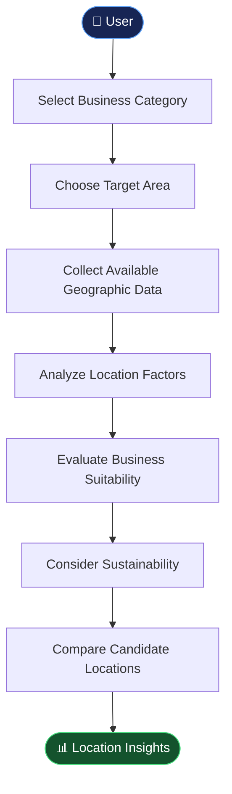
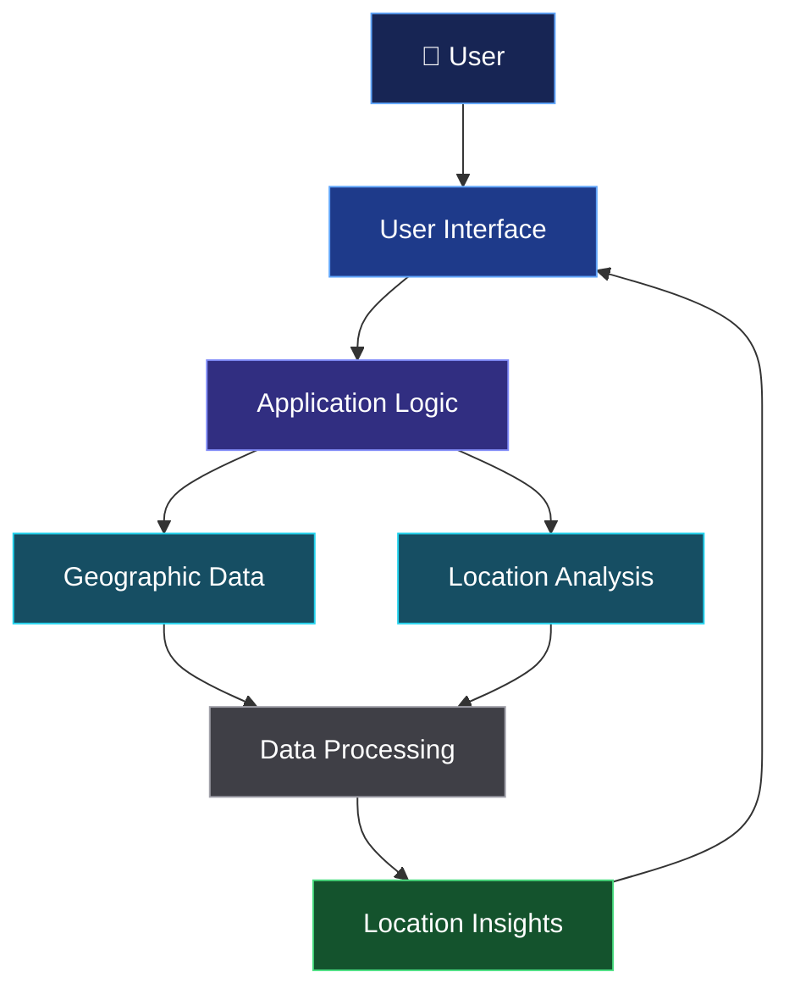

<div align="center">

# 🌍 URBAN NEXUS

### BUSINESS MAPPER

**Smarter Locations. Better Businesses. Sustainable Cities.**

An intelligent business location intelligence platform designed to explore how geographic data, market insights, and sustainability considerations can support better business site selection.

<br/>

**Turning location data into smarter business decisions.**

</div>

---

## 🌆 About the Project

**Urban Nexus: Business Mapper (UNBM)** is a project focused on business location intelligence and sustainable urban development.

Choosing the right location is one of the most important decisions for any business. Customer accessibility, local demand, competition, transportation, and environmental factors can all influence its success.

UNBM explores how geographic information and data-driven analysis can help entrepreneurs evaluate locations more systematically.

### 🎯 Our Vision

> Make business location planning more accessible, data-driven, and sustainability-conscious.

## 🚨 The Problem

Traditional business location selection can depend heavily on assumptions, fragmented information, and manual research.

- 📍 **Location uncertainty:** Finding an area that suits a particular business can be difficult.
- 📊 **Limited insights:** Relevant geographic and market information may be scattered across different sources.
- 🏪 **Competition:** Existing businesses can influence the opportunities available at a location.
- 🚗 **Accessibility:** Transportation and connectivity can affect customers and operations.
- 🌱 **Sustainability:** Environmental considerations may be overlooked during location planning.

## 💡 The Solution

UNBM aims to bring relevant location information and business requirements into a unified decision-support workflow.

The platform's intended approach includes:

| Capability | Purpose |
|---|---|
| 🗺️ Geographic analysis | Understand the characteristics of potential locations |
| 📊 Data-driven evaluation | Compare locations using relevant indicators |
| 🏪 Business suitability | Consider the requirements of different business categories |
| 🚦 Accessibility analysis | Evaluate connectivity and transportation factors |
| 🌱 Sustainability insights | Explore environmental and logistics-related considerations |
| 📈 Location comparison | Help users assess the relative strengths of candidate sites |

*The table describes the project's intended capabilities; actual availability depends on the implementation in the repository.*

---

## ✨ Key Highlights

<div align="center">

| 🗺️ Location Intelligence | 📊 Data-Driven Decisions |
|---|---|
| Explore geographic factors relevant to business locations. | Use available indicators to compare potential sites. |

| 🌱 Sustainable Planning | 🏪 Business-Oriented Analysis |
|---|---|
| Consider environmental and transportation impacts. | Evaluate location requirements for different business categories. |

</div>

## 🔄 How It Works



The diagram illustrates a conceptual workflow for UNBM rather than a verified sequence of implemented application modules.

## 🏪 Potential Use Cases

### 🍰 Retail and Bakeries

Evaluate local demand, accessibility, and nearby competition when considering a new store.

### 🍱 Cloud Kitchens

Explore delivery coverage, transportation distances, and location suitability.

### 💊 Pharmacies

Consider accessibility, surrounding demand indicators, and nearby facilities.

### 🧺 Local Service Businesses

Explore locations for laundry services and other neighborhood-oriented businesses.

### 🌱 Sustainable Urban Development

Investigate how business distribution and accessibility relate to more sustainable urban planning.

---

## 🛠️ Technology Stack

UNBM's exact technology stack should be documented using the dependencies and source files in the repository.

| Layer | Technology |
|---|---|
| Frontend | React JS|
| Backend | Node JS, Express JS |
| Database | MongoDB|
| GIS and Mapping | To be confirmed from implementation |
| Data Analysis | To be confirmed from implementation |
| AI / Machine Learning | If implemented |
| External Services | Actual integrations to be documented |

**Why this matters:** Accurate technology documentation helps developers understand the project, install the right dependencies, and contribute effectively.

---

## 🏗️ Conceptual Architecture



This diagram presents a high-level architectural concept. Replace it with the actual components and data flow once the source code has been verified.

---

## 🚀 Getting Started

### Prerequisites

Install the tools required by the project's actual technology stack.

Depending on the implementation, these may include:

- Git
- Node.js and npm, if the project uses Node.js
- A database, if required
- API credentials, if external services are used

### 1. Clone the Repository

```bash
git clone https://github.com/Yash-Bhalodiya/unbm.git
```

### 2. Enter the Project Directory

```bash
cd unbm
```

### 3. Switch to the GDG Branch

```bash
git fetch origin
git switch -c GDG --track origin/new/GDG
```

If you already have the branch locally, switch to it directly:

```bash
git switch GDG
```

### 4. Install Dependencies

Use the package manager specified by the project.

For an npm-based application, run this command in the directory containing its `package.json`:

```bash
npm install
```

### 5. Configure the Environment

If the application requires environment variables, create the appropriate environment file using the variable names expected by the source code.

Never commit API keys, passwords, or other secrets.

### 6. Run the Application

Check the project's configuration for the correct development command. For Node.js projects, inspect the `scripts` section in `package.json`.

**Note:** The dependency installation and startup commands above are conditional examples. Confirm them against the actual project before using them as definitive setup instructions.

---

## 🌱 Impact

UNBM explores the intersection of three important areas:

**📍 Geography** — Understanding where opportunities exist.

**📊 Intelligence** — Using data to support better decisions.

**🌍 Sustainability** — Considering environmental and transportation impacts.

By bringing these perspectives together, the project aims to support more informed business planning and sustainable urban growth.

## 🤝 Contributing

Contributions, suggestions, and feedback are welcome.

1. Fork the repository.
2. Create a feature branch.
3. Implement your changes.
4. Test the changes.
5. Submit a pull request with a clear description.

```bash
git checkout -b feature/your-feature
git add .
git commit -m "Describe your changes"
git push origin feature/your-feature
```

## 🔮 Future Possibilities

Potential future directions include:

- 🤖 Explainable AI-assisted site recommendations
- 🗺️ Advanced spatial analysis
- 📈 Interactive analytics dashboards
- 🌱 Improved environmental impact estimation
- 📍 Integration of additional geographic datasets
- 📄 Automated business location reports

These enhancements would depend on project priorities, available data, and technical feasibility.

---

<div align="center">

### 🌍 Urban Nexus: Business Mapper

**Smarter Locations. Better Businesses. Sustainable Cities.**

*Exploring a more intelligent approach to business location planning.*

⭐ If you find this project interesting, consider starring the repository!

</div>
